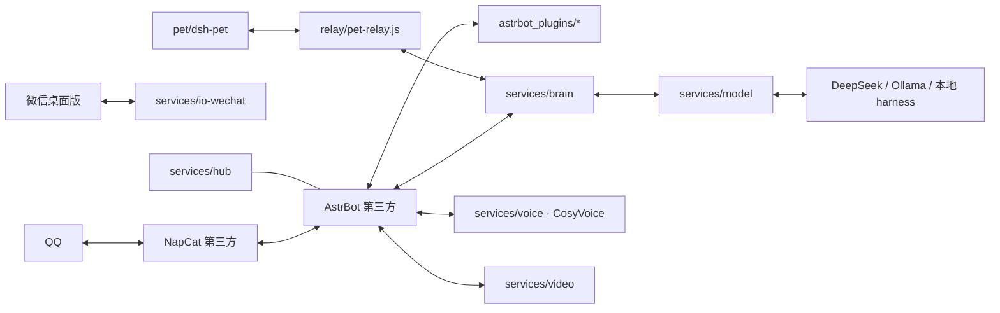

# 大肥鱼 Dafeiyu

[简体中文](README.md) | [English](README_EN.md)

**跑在 Windows 上的 AI 伙伴：会主动找你聊天、自己发表情包，还有五条声线和一只桌宠。**

QQ / 微信双端聊天 · 本地情感语音 · 桌面桌宠 · 模型路由 · 统一控制台

[](https://github.com/newbiecraft-kaixin/dafeiyu-open/stargazers)
[](https://github.com/newbiecraft-kaixin/dafeiyu-open/releases/latest)
[](LICENSE)
[](docs/WINDOWS-DEPLOY.md)

> **不是「又一个 QQ 机器人」**：它平时潜水，冷场才冒泡；会自己补一张表情包；被拍会回拍；主动私聊你之后，还会接着用群里的上下文听你说话。

**下载** → [最新 Release](https://github.com/newbiecraft-kaixin/dafeiyu-open/releases/latest)：插件包 `dafeiyu-plugins-v0.1.0.zip` + 桌宠 `dsh-pet-0.4.1.tgz`
**安装** → 双击仓库根目录的 `install.bat`，按菜单勾选要装的能力（核心 / AstrBot / 插件 / NapCat / 微信桥 / 语音 / 桌宠）
**许可** → AGPL-3.0。本项目是在多个上游开源项目上改造而来，署名、修改时间与再分发要求见 [NOTICE](NOTICE)

只想先看看桌宠长什么样——一条命令装好（前提是本机已装 DeepSeek Harness）：

```powershell
git clone https://github.com/newbiecraft-kaixin/dafeiyu-open.git
cd dafeiyu-open
powershell -ExecutionPolicy Bypass -File .\pet\dsh-pet\install.ps1
```

## 适合谁 / 不适合谁

| 适合 | 不适合 |
|---|---|
| 有一台常开的 Windows 机器，想养一只会主动说话的 QQ/微信伙伴 | 需要 Linux / macOS 或 Docker 一键跑通的人（桌宠与微信桥都绑 Windows） |
| 愿意自己准备模型 API Key 或本地 Ollama，接受本地跑语音要 NVIDIA 显卡 | 想要开箱即用、零配置产品的人 |
| 想研究「拟人聊天 + 表情包 + 桌宠 + 语音」整套链路怎么搭 | 需要多租户、商业化账号体系的人（这是个人向项目） |

## 它和普通 QQ 机器人有什么不同

| | 普通机器人 | 大肥鱼 |
|---|---|---|
| 回复时机 | 每条 @ 都回 | 潜水观察，冷场才插话，有人叫才回 |
| 表达方式 | 纯文字 | 文字 + 自己挑表情包 + QQ 表情 + 拍一拍 / 点赞 / 禁言 |
| 关系方向 | 你找它 | 会主动私聊你（≥180 分钟没聊、9:00–23:00、每天 ≤4 条），之后继续监听你的私聊 |
| 声音 | 系统 TTS | 本地 CosyVoice2 克隆，5 条可切换声线，说话和唱歌同一套 |
| 桌面 | 无 | dsh-pet 桌宠：109 个动作、语音气泡、右键换声线 |

## 一段群聊长什么样（文字示意）

```text
群友A  23:41  今天好累啊
群友B  23:41  早点睡
         …（40 分钟没人说话）
大肥鱼 00:21  这个点还醒着的，是不是都在赶明天的 ddl
群友A  00:22  你怎么知道
大肥鱼 00:22  [表情包：熬夜猫猫头]
```

> 以上是行为示意，实际内容由模型和当时的上下文决定。

> 本仓库是「大肥鱼」自研部分的全链路开源版本，包含 AstrBot 插件、微信桥、模型/语音/视频服务、桌宠前端与部署脚本。
> AstrBot 主程序、NapCat、CosyVoice 模型权重等第三方组件不入库，按下方「依赖与许可」自行安装。

## 来源与改编（Upstream）

本仓库不是从零开始的项目，以下模块是在上游开源项目基础上**改造或对接**而来，版权归上游作者所有：

> 完整署名、修改日期与再分发要求见 [NOTICE](NOTICE)。

| 本项目模块 | 上游项目 | 关系 | 上游许可 |
|---|---|---|---|
| `astrbot_plugins/*` | [AstrBot](https://github.com/AstrBotDevs/AstrBot) | 基于 AstrBot 4.x 插件接口开发；主程序与内置插件未随仓库分发 | AGPL-3.0 |
| `pet/dsh-pet` | [dsh-pet](https://github.com/PC2005-cloud/dsh-pet) | **当前实际在用的桌宠**（DeepSeek Harness 插件）；安装包 `dsh-pet-0.4.1.tgz` 随仓库分发 | MIT |
| `relay/pet-relay.js`、`services/pet` | [clawd-on-desk](https://github.com/rullerzhou-afk/clawd-on-desk) | 桌宠桥接与状态服务（窗口 / 气泡 / 动作 / 语音链路）改造自该项目；壳本体未随仓库分发 | AGPL-3.0 |
| `services/io-wechat`、`astrbot_plugin_wechat_oc_bridge` | [wechatauto-replica](https://github.com/fanyuantaier/wechatauto-replica) | 基于其 UIA 微信自动化库对接 | Apache-2.0 |
| `services/voice`、`tools/` 下的 CosyVoice 脚本、`cosyvoice_ref/` | [CosyVoice](https://github.com/QwenAudio/CosyVoice) | 基于 CosyVoice2 推理服务；代码与模型权重未随仓库分发 | Apache-2.0 |
| 长期记忆能力 | [livingmemory](https://github.com/lxfight-s-Astrbot-Plugins/astrbot_plugin_livingmemory) | 以插件形式依赖，未随仓库分发 | AGPL-3.0 |
| QQ 接入 | [NapCat](https://github.com/NapNeko/NapCatQQ) | QQ 协议端，未随仓库分发 | AGPL-3.0 |

本仓库原创部分：`services/hub`、`model`、`store`、`brain`、`audio`、`video`、`subtitle`、`shared/infra`，以及 `human_sim`、`group_window`、`sticker_pack`、`face_convert`、`tool_gate`、`provider_router`、`basic_tools` 等插件。

二次分发时请保留上述项目的版权与许可声明，并同样以 AGPL-3.0 开源；上游组件未随仓库分发，安装与使用请遵守其各自许可。

## 能力概览

- **QQ 端**：NapCat + AstrBot，支持群聊/私聊、拟人化回复、表情回应、点赞、禁言、图片/表情包、群窗口记忆。
- **微信端**：`services/io-wechat` 通过 Windows UIA 操作桌面微信，收发消息、会话复用、桌面让路（用户在用模拟器/全屏应用时不抢前台）。
- **大脑与模型路由**：`services/brain` 负责任务编排、人设、上下文；`services/model` 统一 OpenAI 兼容 / Ollama / 本地 harness 提供方。
- **语音**：本地 CosyVoice2 情感 TTS（可克隆声线），不可用时自动回退 edge-tts。
- **视频/音乐**：`services/video` 提供解析与信息流 UI；`web_lookup` 插件支持 B 站、抖音、快手、西瓜的搜索/刷视频。
- **桌宠**：`pet/dsh-pet`（**实际在跑的桌面宠物**，DSH 插件，自带 109 个动作动画与 Electron 运行时）、`relay/pet-relay.js` 负责与大脑/桌宠桥接。
- **控制台**：`services/hub` 聚合各服务健康状态与启停。

## 架构



## 按需安装：核心 / 插件 / 桌宠 / 远程访问

整套全开对机器有要求。仓库按安装包组织，**可以只装核心**，插件、桌宠、远程访问按需追加：

| 安装包 | 内容 | 什么时候装 | 最低配置 |
|---|---|---|---|
| **① 核心（必装）** | `services/hub`、`services/model`、`services/store`、`services/brain`、`shared/infra`、`tools/windows/start-core.bat` | 想跑大脑/模型路由/记忆/控制台 | 无 GPU 也能跑（模型走云端 API） |
| **② 插件（可选）** | `astrbot_plugins/*` + `services/io-wechat`（NapCat 接入）+ `services/voice`、`audio`、`video`、`stickers`、`subtitle` + AstrBot / NapCat 本体 | 想要 QQ/微信聊天、语音、看视频等能力 | 建议双端聊天至少 8G 内存；本地语音需 NVIDIA GPU（2~4G 显存），无 GPU 自动回退 edge-tts |
| **③ 桌宠（可选）** | `pet/dsh-pet`（本机同款，安装包已随仓库）+ `relay/pet-relay.js`、`services/pet`、`services/subtitle` | 想要桌面宠物 | dsh-pet 是 Electron，集显可跑 |
| **④ 远程访问（可选）** | 樱花 SakuraFrp 客户端 + 一条 `TCP` 隧道 → 本机 `23408` | 人在外面也想看/操作控制台 | 免费额度够用；没有公网 IP 也能用 |

> 组合示例：只跑核心 = 一台轻量机器（或 NAS）跑 hub/model/store/brain；聊天插件装在另一台有微信/QQ 的机器上；桌宠装在平时用的电脑上。三包拆开部署互不依赖启动顺序，通过端口互通即可。
> 远程访问**只穿透 `23408`**，`3000`、`6199`、`6099`、`6185` 一律留在内网，详见 [GETTING-STARTED 12.2](docs/GETTING-STARTED.md#122-樱花内网穿透sakurafrp)。
>
> **机器吃不消？** 逐项降级方案见 [docs/DEGRADED.md](docs/DEGRADED.md)：哪些能力可以整块不装、表情包怎么改成手动管库、没有显卡/没装 DSH 时损失什么。

## 目录

```
astrbot_plugins/     AstrBot 自研插件（human_sim、web_lookup、group_window 等）→ 安装包②
services/
  hub/ model/ store/ brain/   核心四服务                          → 安装包①
  io-wechat/         微信桌面端桥（UIA 驱动、收发、窗口让路）      → 安装包②
  voice/ audio/ video/ stickers/ subtitle/  能力服务             → 安装包②（按需）
  pet/               桌宠服务                                     → 安装包③
shared/infra/        共享基础设施（端口、配置、日志）              → 安装包①
pet/
  dsh-pet/           本机在跑的桌宠（dsh-pet 0.4.1 安装包 + 安装脚本） → 安装包③
  tools/             桌宠构建/素材脚本                            → 安装包③
relay/               桌宠与大脑桥接（pet-relay.js）               → 安装包③
stack/               Docker 部署参考（compose / Dockerfile / 人设）
tools/               CosyVoice 安装脚本、Windows 启动脚本（start-core.bat = 核心四服务一键启动）
docs/                架构与 Windows 部署说明
astrbot-win/         AstrBot 示例数据（插件配置模板、表情包池、文生图模板） → 安装包②
cosyvoice_ref/       声线参考音与 profiles 档案（说话 / 唱歌共用）        → 安装包②
```

## 插件清单（`astrbot_plugins/`）

18 个插件都自带 `config.json`，复制到 AstrBot 的 `data/plugins/` 下即可启用（或用 `tools/windows/install-plugins.ps1` 一键安装）。
**每个插件的指令、配置项、依赖关系见 [docs/PLUGINS.md](docs/PLUGINS.md)**，全部指令有速查表。

其中三个已拆成独立仓库，可以直接在 AstrBot 插件市场搜索安装（市场一条记录对应一个仓库根）：

- [astrbot_plugin_human_sim](https://github.com/newbiecraft-kaixin/astrbot_plugin_human_sim) — 群内拟人
- [astrbot_plugin_sticker_pack](https://github.com/newbiecraft-kaixin/astrbot_plugin_sticker_pack) — 表情包索引
- [astrbot_plugin_web_lookup](https://github.com/newbiecraft-kaixin/astrbot_plugin_web_lookup) — 联网查证 + 视频解析

| 插件 | 作用 |
|---|---|
| `astrbot_plugin_human_sim` | 群内拟人：潜水插话、冷场开话头、冒泡发 QQ 表情、发表情包；拍一拍全链路 |
| `astrbot_plugin_humanizer` | 人味处理：清洗 Markdown 结构、AI 腔样板句、长句排比，防复读 |
| `astrbot_plugin_group_window` | 被动记录每个群的聊天窗口（不唤醒不回复），机器人发言时注入上下文 |
| `astrbot_plugin_speaker_tag` | 消息补 `[昵称/时间]` 标签、群历史截断、每人档案按会话隔离 |
| `astrbot_plugin_provider_router` | 群聊自动切本地 Ollama、好友私聊走云端；`/模型` `/转换` 切换 |
| `astrbot_plugin_basic_tools` | 基础工具：时间/群成员/戳一戳/提醒/天气/查头像；`/听歌` `/声线` `/停` `/定时任务` |
| `astrbot_plugin_sticker_pack` | 回复里的 `:情绪词:` 按语义从全库挑图，单独成条发送 |
| `astrbot_plugin_face_convert` | 把 `[流泪]` `[doge]` 等文字表情转成真实 QQ 表情段 |
| `astrbot_plugin_qzone_channel` | QQ 空间独立信道：轮询自己说说下的新评论，用独立上下文回复 |
| `astrbot_plugin_daily_qzone` | 每天自动发一条 QQ 空间动态，内容优先取当日群聊总结 |
| `astrbot_plugin_web_lookup` | 联网查证：搜索候选 → 校验 → 抓正文 → 相似度挑最相关页面 |
| `astrbot_plugin_self_growth` | 把经验教训记进成长笔记，并自动注入系统提示，形成学习闭环 |
| `astrbot_plugin_care_ping` | 冷场时主动私聊主人：≥180 分钟空闲、09:00–23:00、每天 ≤4 条 |
| `astrbot_plugin_local_tools` | 给 AI 本机文件读写与命令执行权限（默认仅主人可用） |
| `astrbot_plugin_tool_gate` | 按群决定模型/人设/工具集，支持一键预设与私聊接入 |
| `astrbot_plugin_dafeiyu_pet` | 把 QQ/微信消息与回复状态转给桌宠中转服务（默认 `127.0.0.1:23334`） |
| `astrbot_plugin_qq_mcp` | 发消息（拆条+打字节奏）/查历史/戳一戳封装成 MCP 工具，供 DSH 调用 |
| `astrbot_plugin_wechat_oc_bridge` | 把本机 io-wechat（PC 微信小号 RPA）接入 AstrBot，回复走同一个小号 |

## 快速开始（Windows）

> 第一次上手建议直接看 [docs/GETTING-STARTED.md](docs/GETTING-STARTED.md)：环境要求、选装组合、启动顺序、端口速查和常见报错都写在一起。

### ⓪ 一键安装（推荐）

双击仓库根目录的 `install.bat`，按编号勾选要装的能力：

| 编号 | 内容 | 说明 |
| --- | --- | --- |
| 1 | 运行环境 | 检测 Python 3.12+ / Node 20+，缺失时用 winget 安装；创建 `astrbot-win\venv` |
| 2 | 核心四服务 | hub / model / store / brain，校验目录并写入 `.env` 密钥 |
| 3 | AstrBot | 自动下载源码、安装 AstrBot 与插件附加依赖（edge-tts / imageio-ffmpeg / faster-whisper / numpy / requests）、带入仓库自带 data |
| 4 | 大肥鱼插件包 | 18 个插件复制进 AstrBot 的 `data/plugins` |
| 5 | NapCat | 自动下载最新 Release 并解压，提示运行一次安装器 |
| 6 | 微信桥 | 安装 `uiautomation` 与 `wechatauto` |
| 7 | CosyVoice2 | 调用 `tools/setup_cosyvoice.py`，torch + 模型约 3GB |
| 8 | 桌宠 dsh-pet | 装进 DSH profile（需已安装 DeepSeek Harness） |
| 9 | 启动核心 | 启动四服务并打开 http://127.0.0.1:23408 |

输入 `2` 只装核心，`a` 全装，直接回车等于 `1,2`。也可以用参数：

```powershell
.\install.bat -Check          # 只体检，不修改
.\install.bat -Select 2,4     # 只装核心 + 插件
.\install.bat -Select all -Yes
.\install.bat -DryRun         # 演示流程
```

AstrBot、NapCat、CosyVoice 由安装器下载；DeepSeek Harness 未公开发布，需自行安装（安装器会检测 `%USERPROFILE%\.dsh\profiles\web`）。

### ① 核心四服务（低配机器从这里开始）

1. 安装 Python 3.11+、Node.js 20+（如果后面要装 AstrBot，Python 必须是 3.12+）。
2. 运行 `tools/windows/start-core.bat` —— 只启动 `hub 23408 / model 23406 / store 23407 / brain 23402` 四个服务（lite 模式，脚本按自身位置自动定位仓库根目录）。
3. 模型密钥通过环境变量注入（如 `DEEPSEEK_API_KEY`），见 `services/model/providers.json`。不装插件/桌宠时，这就是全部。

### ② 插件（聊天/语音/视频能力）

1. 从官方渠道安装第三方组件（仓库不携带这些程序，各版本的下载地址、安装位置与验收方式见 [docs/GETTING-STARTED.md](docs/GETTING-STARTED.md#3-上游组件官方地址与落地位置)）：
   - [AstrBot](https://github.com/AstrBotDevs/AstrBot)：Windows 推荐官方 [AstrBot Launcher](https://github.com/AstrBotDevs/astrbot-launcher/releases) 安装包，或按[官方文档](https://docs.astrbot.app/deploy/astrbot/windows.html)用源码运行，需 Python 3.12+，WebUI 默认 <http://127.0.0.1:6185>。
   - [NapCat](https://github.com/NapNeko/NapCatQQ/releases)：下载 `NapCat.Shell.Windows.OneKey.zip`，解压后先运行一次 `NapCatInstaller.exe`。
   - 可选：[CosyVoice](https://github.com/QwenAudio/CosyVoice) + 权重 [`iic/CosyVoice2-0.5B`](https://www.modelscope.cn/models/iic/CosyVoice2-0.5B)（本地语音）、[Ollama](https://ollama.com/download/windows)（本地模型）。
2. 把 `astrbot_plugins/*` 复制到 AstrBot 的 `data/plugins/`，按需只启用你想要的插件。
3. 按 [docs/WINDOWS-DEPLOY.md](docs/WINDOWS-DEPLOY.md) 启动 `io-wechat`（微信桥）、`voice/audio/video` 等能力服务。各服务默认端口见 [`services`](services) 下每个目录的 `service.json`，完整端口表、防火墙放行与反向代理见 [GETTING-STARTED 第 12 节](docs/GETTING-STARTED.md#12-端口速查)。
4. NapCat 要同时开两条通道：反向 WS `6199`（收发主通道）和 HTTP `3000`（主动发消息，缺了会提示「napcat 不在线」）。

### ③ 桌宠

**桌宠（本机在跑的那只）**

1. 本机已安装 DeepSeek Harness（DSH）。**DSH 目前未公开发布，没有官方下载地址，本仓库也不分发**，所以只有已经装过 DSH 的机器才能走这条路。
2. 确认 `%USERPROFILE%\.dsh\profiles\web` 存在（不存在说明 DSH 没装过或没启动过）。
3. 运行 `powershell -ExecutionPolicy Bypass -File .\pet\dsh-pet\install.ps1`：把仓库自带的 `dsh-pet-0.4.1.tgz` 装进 DSH profile、下载 Electron、并把插件写进 bundles。
4. 重启 DSH，在插件列表启用 `dsh-pet`，桌宠即出现在桌面（自带 109 个动作动画）。个人数据在 `%USERPROFILE%\.dsh\dsh-pet`。
5. 需要和大脑联动时再启动 `relay/pet-relay.js`（23334）与 `services/pet`。

详见 [pet/dsh-pet/README.md](pet/dsh-pet/README.md)。

> 仓库里的脚本和配置默认按仓库根解析路径，克隆到任意目录都能直接用；只有把组件装在仓库外时，才需要把对应字段改成绝对路径。

### 中英文界面与字幕

- **网页**：hub（23408）、audio（23366）、video（23368）、subtitle（23405）的页面右下角有 `EN / 中文` 切换按钮，选择记在 `localStorage['dafeiyu.lang']`；也可以直接带参数打开，如 `http://127.0.0.1:23408/?lang=en`。两者都没有时按浏览器语言判断，英文环境默认英文。
- **字幕**：`POST /asr`、`POST /vision` 支持 `"lang": "zh" | "en" | "auto"`，缺省取环境变量 `SUBTITLE_LANG`（未设置时为 `zh`）。英文时 whisper 使用 `language=en`，画面描述也返回英文；`auto` 交给 whisper 自动识别。
- 翻译字典在 `shared/i18n/zh-en.json`（key 为中文原文），改完刷新页面即生效，无需重新构建。

### 音色训练（seed-vc）参数与权重

入口：audio 服务的 `/ui/train` 页面，对应 `POST /train/jobs`。在本机对 seed-vc 做微调，输入单条人声 1~30 秒或一个数据集目录，输出一份独立音色权重，不覆盖基础模型。

**任务参数（页面 / 接口可调）**

| 参数 | 默认 | 范围 | 说明 |
| --- | --- | --- | --- |
| `name` | 必填 | — | 音色名，用于生成 `run_name` 和数据集目录 |
| `ref_path` | 必填 | — | 人声文件或数据集目录（wav/mp3/flac/m4a/ogg/opus） |
| `steps` | 1000 | 1 ~ 500000 | 训练步数，即 `--max-steps` |
| `batch_size` | 2 | 1 ~ 32 | 显存不足时降到 1 |
| `gpu` | 0 | 0 ~ 15 | 使用的显卡编号 |
| `bf16` | false | true / false | 30/40 系显卡建议开启 |

**训练命令固定部分**：`--config configs/presets/config_dit_mel_seed_uvit_xlsr_tiny.yml`、`--save-every min(500, steps)`、`--num-workers 0`。

**配置里的权重与模型参数**（`<seed-vc>/configs/presets/config_dit_mel_seed_uvit_xlsr_tiny.yml`）

| 项 | 值 |
| --- | --- |
| `base_lr`（学习率） | `0.0001` |
| `epochs` | 1000（第一阶段） |
| `batch_size` / `batch_length` / `max_len` | 2 / 100 秒 / 80 帧 |
| `pretrained_model` | `DiT_uvit_tat_xlsr_ema.pth` |
| 损失 / 扩散 | `l1` / `flow` |
| DiT | hidden 384、6 头、9 层、block 8192、输入 80 通道 |
| 语音 tokenizer | `xlsr` 第 12 层（`facebook/wav2vec2-xls-r-300m`） |
| 梅尔频谱 | sr 22050、n_fft/win 1024、hop 256、80 mel、fmax 8000 |
| 声码器 / 音色编码器 | hifigan / campplus（dim 192） |

**权重产物**

- 最终权重：`<seed-vc>/runs/<run_name>/ft_model.pth`
- 过程检查点：同目录下 `DiT_epoch_XXXXX_step_XXXXX.pth`，每 `save-every` 步保存一次
- 任务与日志：`services/audio/data/jobs.json`、`services/audio/data/logs/<job_id>.log`；训练集副本在 `services/audio/data/datasets/<音色名>/<run_name>/`
- 备份或迁移只需复制整个 `runs/<run_name>/`；删除该目录即可回退到原始音色

## 配置与密钥

- 模型密钥通过环境变量注入（如 `DEEPSEEK_API_KEY`），见 `services/model/providers.json`。
- 语音/微信/QQ 的本地配置在各自服务的 `config.json` 或 `service.json` 中。
- **本仓库不包含任何真实 Token、Cookie、账号、聊天记录或运行数据库。** 首次运行需要自行登录 QQ/微信并生成配置。

## 常见问题

**Q：一定要 Windows 吗？**
A：是。桌宠基于 Electron 且用 DSH profile，微信桥走 Windows UIA；核心四服务（hub/model/store/brain）本身是 Python，理论上能跑在别的系统上，但没有适配也没有测试。

**Q：没有显卡能跑吗？**
A：能。不装本地语音时模型走云端 API 或本地 Ollama，无 GPU 即可；要本地 CosyVoice2 需要 NVIDIA 显卡约 2~4GB 显存，装不上会自动回退 edge-tts。

**Q：DeepSeek Harness（DSH）在哪下载？**
A：目前未公开发布，本仓库也不分发，所以桌宠安装脚本只对已装过 DSH 的机器有效。没有 DSH 可以先跑聊天部分（安装包①+②）。

**Q：会封号吗？**
A：QQ 走 NapCat、微信走 UIA 模拟操作，都属于非官方接入，平台风控与条款风险请自行评估，建议用小号。

**Q：仓库里有作者的账号、配置或聊天记录吗？**
A：没有。所有 Token、Cookie、账号、聊天库都在运行目录的 `data/` 下，已被 `.gitignore` 排除，首次运行需自行登录生成。

**Q：桌宠没有海草和背景泡泡？**
A：先跑 `.\pet\dsh-pet\install.ps1 -Backdrop check`，确认 dsh-pet 版本是 0.4.1、`bubbleBackdropEnabled` 不为 `false`；再跑 `-Backdrop on` 打开。详见 [pet/dsh-pet/README.md](pet/dsh-pet/README.md)。

**Q：这个项目是完全原创的吗？**
A：不是。核心代码原创，桌宠桥接、微信自动化、语音链路改造自上游项目，逐项来源见上文「来源与改编」与 [NOTICE](NOTICE)。

## 已知限制

- 本文档描述的是**全量形态（L3）**；L0~L2 的降级差异、以及各能力单独关掉后的行为，见 [docs/DEGRADED.md](docs/DEGRADED.md)。
- 微信侧依赖桌面客户端 + Windows UIA，必须在已登录、窗口可见的桌面会话中运行；不同微信版本控件可能变化。
- 微信 / QQ 自动化可能违反平台条款，存在账号风控风险，请自行评估并遵守平台规则。
- 语音合成需要 NVIDIA GPU（CosyVoice2 约 2~4GB 显存）；无 GPU 时自动回退 edge-tts。

## 依赖与许可

本项目以 **AGPL-3.0** 发布，因为我们大量依赖并修改了同为 AGPL-3.0 的生态组件（模块级对应关系见上文「来源与改编」）：

| 组件 | 许可 | 说明 |
|---|---|---|
| [AstrBot](https://github.com/AstrBotDevs/AstrBot) | AGPL-3.0 | 插件宿主，未随本仓库分发 |
| [clawd-on-desk](https://github.com/rullerzhou-afk/clawd-on-desk) | AGPL-3.0 | 桌宠壳改造自该项目，未随本仓库分发 |
| [livingmemory](https://github.com/lxfight-s-Astrbot-Plugins/astrbot_plugin_livingmemory) | AGPL-3.0 | 长期记忆插件，未随本仓库分发 |
| [NapCat](https://github.com/NapNeko/NapCatQQ) | AGPL-3.0 | QQ 协议端，未随本仓库分发 |
| [wechatauto-replica](https://github.com/fanyuantaier/wechatauto-replica) | Apache-2.0 | 微信自动化库，以依赖形式安装 |
| [CosyVoice](https://github.com/QwenAudio/CosyVoice) | Apache-2.0 | 语音合成，模型与代码未随本仓库分发 |

如果你分发本项目的修改版本，请同样以 AGPL-3.0 开源，并保留上述项目的版权与许可声明。

## 安全

请阅读 [SECURITY.md](SECURITY.md)。不要在 Issue 中贴出账号、Cookie、Token 或聊天记录。
