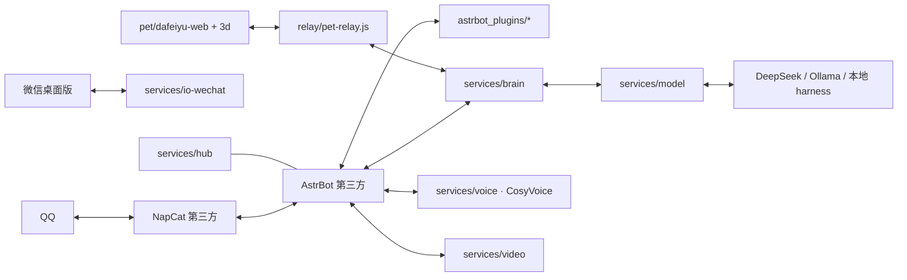

# 大肥鱼 Dafeiyu

一个跑在 Windows 上的多平台 AI 伙伴：QQ / 微信双端聊天、本地情感语音、桌面桌宠、模型路由和统一控制台。

> 本仓库是「大肥鱼」自研部分的全链路开源版本，包含 AstrBot 插件、微信桥、模型/语音/视频服务、桌宠前端与部署脚本。
> AstrBot 主程序、NapCat、CosyVoice 模型权重等第三方组件不入库，按下方「依赖与许可」自行安装。

## 能力概览

- **QQ 端**：NapCat + AstrBot，支持群聊/私聊、拟人化回复、表情回应、点赞、禁言、图片/表情包、群窗口记忆。
- **微信端**：`services/io-wechat` 通过 Windows UIA 操作桌面微信，收发消息、会话复用、桌面让路（用户在用模拟器/全屏应用时不抢前台）。
- **大脑与模型路由**：`services/brain` 负责任务编排、人设、上下文；`services/model` 统一 OpenAI 兼容 / Ollama / 本地 harness 提供方。
- **语音**：本地 CosyVoice2 情感 TTS（可克隆声线），不可用时自动回退 edge-tts。
- **视频/音乐**：`services/video` 提供解析与信息流 UI；`web_lookup` 插件支持 B 站、抖音、快手、西瓜的搜索/刷视频。
- **桌宠**：`pet/dafeiyu-web`（Electron 壳）、`pet/dafeiyu3d`（Three.js 场景）、`relay/pet-relay.js` 负责与大脑/桌宠桥接。
- **控制台**：`services/hub` 聚合各服务健康状态与启停。

## 架构



## 目录

```
astrbot_plugins/     AstrBot 自研插件（human_sim、web_lookup、group_window 等）
services/
  io-wechat/         微信桌面端桥（UIA 驱动、收发、窗口让路）
  brain/             大脑/人设/任务编排
  model/             模型提供方与路由
  video/             视频解析与信息流
  hub/               服务控制台
  audio/ subtitle/ store/ stickers/  辅助服务
shared/infra/        共享基础设施（端口、配置、日志）
pet/
  dafeiyu-web/       桌宠 Electron 前端
  dafeiyu3d/         桌宠 Three.js 场景
  tools/             桌宠构建/素材脚本
relay/               桌宠与大脑桥接
stack/               Docker 部署参考（compose / Dockerfile / 人设）
tools/               CosyVoice 安装与服务脚本、Windows 启动脚本
docs/                架构与 Windows 部署说明
```

## 快速开始（Windows）

1. 安装 Python 3.11+、Node.js 20+，以及第三方组件：
   - [AstrBot](https://github.com/AstrBotDevs/AstrBot)（本项目按 AstrBot 4.x 插件接口开发）
   - [NapCat](https://github.com/NapNeko/NapCatQQ)（QQ 协议端）
   - 可选：CosyVoice2（本地语音）、Ollama（本地模型）
2. 把 `astrbot_plugins/*` 复制到 AstrBot 的 `data/plugins/`。
3. 按 [docs/WINDOWS-DEPLOY.md](docs/WINDOWS-DEPLOY.md) 修改 `tools/windows/*.bat` 里的路径并依次启动。
4. 各服务默认端口见 [`services`](services) 下每个目录的 `service.json`。

> 仓库里的启动脚本、配置中的路径均为占位符 `C:\path\to\dafeiyu`，需要替换成你的实际目录。

## 配置与密钥

- 模型密钥通过环境变量注入（如 `DEEPSEEK_API_KEY`），见 `services/model/providers.json`。
- 语音/微信/QQ 的本地配置在各自服务的 `config.json` 或 `service.json` 中。
- **本仓库不包含任何真实 Token、Cookie、账号、聊天记录或运行数据库。** 首次运行需要自行登录 QQ/微信并生成配置。

## 已知限制

- 微信侧依赖桌面客户端 + Windows UIA，必须在已登录、窗口可见的桌面会话中运行；不同微信版本控件可能变化。
- 微信 / QQ 自动化可能违反平台条款，存在账号风控风险，请自行评估并遵守平台规则。
- 语音合成需要 NVIDIA GPU（CosyVoice2 约 2~4GB 显存）；无 GPU 时自动回退 edge-tts。

## 依赖与许可

本项目以 **AGPL-3.0** 发布，因为我们大量依赖并修改了同为 AGPL-3.0 的生态组件：

| 组件 | 许可 | 说明 |
|---|---|---|
| [AstrBot](https://github.com/AstrBotDevs/AstrBot) | AGPL-3.0 | 插件宿主，未随本仓库分发 |
| [clawd-on-desk](https://github.com/rullerzhou-afk/clawd-on-desk) | AGPL-3.0 | 桌宠壳参考，未随本仓库分发 |
| [livingmemory](https://github.com/lxfight-s-Astrbot-Plugins/astrbot_plugin_livingmemory) | AGPL-3.0 | 长期记忆插件，未随本仓库分发 |
| [NapCat](https://github.com/NapNeko/NapCatQQ) | AGPL-3.0 | QQ 协议端，未随本仓库分发 |
| [wechatauto-replica](https://github.com/fanyuantaier/wechatauto-replica) | Apache-2.0 | 微信自动化库，以依赖形式安装 |
| [CosyVoice](https://github.com/FunAudioLLM/CosyVoice) | Apache-2.0 | 语音合成，模型与代码未随本仓库分发 |

如果你分发本项目的修改版本，请同样以 AGPL-3.0 开源，并保留上述项目的版权与许可声明。

## 安全

请阅读 [SECURITY.md](SECURITY.md)。不要在 Issue 中贴出账号、Cookie、Token 或聊天记录。
