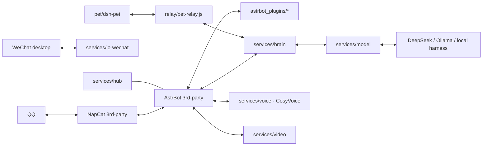

# Dafeiyu (大肥鱼)

[English](README_EN.md) | [简体中文](README.md)

**An AI companion that runs on Windows: it starts conversations on its own, picks its own stickers, and comes with five switchable voices and a desktop pet.**

QQ / WeChat chat · Local expressive TTS · Desktop pet · Model routing · Unified console

[](https://github.com/newbiecraft-kaixin/dafeiyu-open/stargazers)
[](https://github.com/newbiecraft-kaixin/dafeiyu-open/releases/latest)
[](LICENSE)
[](docs/WINDOWS-DEPLOY.md)

> **Not "yet another QQ bot"**: it lurks by default and only speaks up when the group goes quiet; it attaches stickers on its own; it pokes you back when poked; and after it DMs you first, it keeps listening with the group context.

**Download** → [Latest release](https://github.com/newbiecraft-kaixin/dafeiyu-open/releases/latest): plugin pack `dafeiyu-plugins-v0.1.0.zip` + desktop pet `dsh-pet-0.4.1.tgz`
**Install** → double-click `install.bat` in the repo root and pick what you need (core / AstrBot / plugins / NapCat / WeChat bridge / voice / pet); for just the desktop pet run `powershell -ExecutionPolicy Bypass -File .\pet\dsh-pet\install.ps1` (requires DeepSeek Harness to be installed already)

> **Note**: this project is built around Chinese platforms (QQ / WeChat / Bilibili) and Chinese TTS voices. The bot's persona and prompts are Chinese-first — international users should expect to adapt personas, platform access, and voice references.

## How it differs from a typical QQ bot

| | Typical bot | Dafeiyu |
|---|---|---|
| When to reply | Replies to every @ | Lurks and observes, interjects when the group goes quiet, answers when called |
| Expression | Plain text | Text + self-picked stickers + QQ emotes + poke / like / mute actions |
| Direction | You reach out to it | It DMs you first (≥180 min idle, 9:00–23:00, ≤4/day), then keeps listening with group context |
| Voice | System TTS | Local CosyVoice2 voice cloning, 5 switchable voices, same set for talking and singing |
| Desktop | None | dsh-pet desktop pet: 109 actions, voice bubbles, right-click voice switch |

## What a group chat looks like (illustration)

```text
FriendA  23:41  so tired today
FriendB  23:41  sleep early
         … (40 minutes of silence)
Dafeiyu  00:21  everyone still awake at this hour is definitely racing a deadline
FriendA  00:22  how did you know
Dafeiyu  00:22  [sticker: stay-up-late cat]
```

> Illustration only — actual content comes from the model and the conversation context at the time.

> This repo is the full-chain open-source release of Dafeiyu's self-developed parts: AstrBot plugins, the WeChat bridge, model/voice/video services, the desktop pet frontends, and deployment scripts.
> Third-party components (AstrBot core, NapCat, CosyVoice model weights) are not distributed here — install them yourself per "Dependencies & licensing" below.

## Upstream projects

This is not a from-scratch project. The following modules are **adapted from or integrated with** upstream open-source projects, whose copyright belongs to their authors:

| Module here | Upstream | Relationship | Upstream license |
|---|---|---|---|
| `astrbot_plugins/*` | [AstrBot](https://github.com/AstrBotDevs/AstrBot) | Built on the AstrBot 4.x plugin API; host and built-in plugins not distributed | AGPL-3.0 |
| `pet/dsh-pet` | [dsh-pet](https://github.com/PC2005-cloud/dsh-pet) | **The desktop pet actually in use** (DeepSeek Harness plugin); installer `dsh-pet-0.4.1.tgz` distributed with this repo | MIT |
| `relay/pet-relay.js`, `services/pet` | [clawd-on-desk](https://github.com/rullerzhou-afk/clawd-on-desk) | Pet bridge and status service (window / bubble / actions / voice chain) adapted from it; the shell itself not distributed | AGPL-3.0 |
| `services/io-wechat`, `astrbot_plugin_wechat_oc_bridge` | [wechatauto-replica](https://github.com/fanyuantaier/wechatauto-replica) | Integrated via its UIA WeChat automation library | Apache-2.0 |
| `services/voice`, CosyVoice scripts in `tools/`, `cosyvoice_ref/` | [CosyVoice](https://github.com/QwenAudio/CosyVoice) | Built on the CosyVoice2 inference service; code and model weights not distributed | Apache-2.0 |
| Long-term memory | [livingmemory](https://github.com/lxfight-s-Astrbot-Plugins/astrbot_plugin_livingmemory) | Depended on as a plugin, not distributed | AGPL-3.0 |
| QQ access | [NapCat](https://github.com/NapNeko/NapCatQQ) | QQ protocol side, not distributed | AGPL-3.0 |

Original parts of this repo: `services/hub`, `model`, `store`, `brain`, `audio`, `video`, `subtitle`, `shared/infra`, plus plugins such as `human_sim`, `group_window`, `sticker_pack`, `face_convert`, `tool_gate`, `provider_router`, `basic_tools`.

When redistributing, keep the copyright and license notices of the projects above and license your version under AGPL-3.0 as well.

## Capabilities

- **QQ**: NapCat + AstrBot — group/private chat, human-like replies, emote reactions, likes, mutes, images/stickers, per-group context windows.
- **WeChat**: `services/io-wechat` drives desktop WeChat via Windows UIA — send/receive, session reuse, and desktop yielding (never steals foreground while you game or run full-screen apps).
- **Brain & model routing**: `services/brain` handles orchestration, persona, and context; `services/model` unifies OpenAI-compatible / Ollama / local harness providers.
- **Voice**: local CosyVoice2 expressive TTS with voice cloning; falls back to edge-tts automatically when unavailable.
- **Video/music**: `services/video` provides parsing and a feed UI; the `web_lookup` plugin supports Bilibili / Douyin / Kuaishou / Xigua search and feed browsing.
- **Desktop pet**: `pet/dsh-pet` (**the pet actually in use**, a DSH plugin with 109 action animations and its own Electron runtime), with `relay/pet-relay.js` bridging brain and pet.
- **Console**: `services/hub` aggregates service health and start/stop.

## Architecture



## Install by bundle: core / plugins / pet

Running everything is demanding. The repo is organized into three bundles — **the core alone is enough to boot**, plugins and the pet are optional add-ons:

| Bundle | Contents | When | Minimum specs |
|---|---|---|---|
| **① Core (required)** | `services/hub`, `services/model`, `services/store`, `services/brain`, `shared/infra`, `tools/windows/start-core.bat` | Brain / model routing / memory / console | Runs without a GPU (models via cloud APIs) |
| **② Plugins (optional)** | `astrbot_plugins/*` + `services/io-wechat` (NapCat access) + `services/voice`, `audio`, `video`, `stickers`, `subtitle` + AstrBot / NapCat themselves | QQ/WeChat chat, voice, video | 8 GB RAM recommended; local voice needs an NVIDIA GPU (2–4 GB VRAM), otherwise auto-fallback to edge-tts |
| **③ Pet (optional)** | `pet/dsh-pet` (same build as this machine, installer included) + `relay/pet-relay.js`, `services/pet`, `services/subtitle` | Desktop pet | dsh-pet is Electron — integrated graphics is fine |

> Example split: run the core (hub/model/store/brain) on a lightweight box or NAS, chat plugins on a machine with WeChat/QQ, and the pet on your daily desktop. The three bundles start independently and talk over ports.

## Layout

```
astrbot_plugins/     Self-developed AstrBot plugins (human_sim, web_lookup, group_window, ...) → Bundle ②
services/
  hub/ model/ store/ brain/   Core four services                                              → Bundle ①
  io-wechat/         WeChat desktop bridge (UIA-driven, send/receive, window yielding)       → Bundle ②
  voice/ audio/ video/ stickers/ subtitle/  Capability services                              → Bundle ② (optional)
  pet/               Desktop pet service                                                     → Bundle ③
shared/infra/        Shared infrastructure (ports, config, logging)                          → Bundle ①
pet/
  dsh-pet/           The pet actually in use (dsh-pet 0.4.1 installer + install script)      → Bundle ③
  tools/             Pet build/asset scripts                                                 → Bundle ③
relay/               Brain-pet bridge (pet-relay.js)                                         → Bundle ③
stack/               Docker deployment reference (compose / Dockerfile / persona)
tools/               CosyVoice setup, Windows launch scripts (start-core.bat = one-click core)
docs/                Architecture and Windows deployment guides
astrbot-win/         Sample AstrBot data (plugin config templates, sticker pool, t2i templates) → Bundle ②
cosyvoice_ref/       Voice reference audio & profiles (shared by talking and singing)        → Bundle ②
```

## Plugins (`astrbot_plugins/`)

All 18 plugins ship with their own `config.json` — drop them into AstrBot's `data/plugins/` (or use `tools/windows/install-plugins.ps1` to install them all at once).
**Per-plugin commands, config keys, and dependencies: see [docs/PLUGINS.md](docs/PLUGINS.md)** (Chinese) — it includes a full command cheat sheet.

| Plugin | What it does |
|---|---|
| `astrbot_plugin_human_sim` | Human-like group behavior: lurk & interject, break silences, send QQ emotes & stickers; full poke chain |
| `astrbot_plugin_humanizer` | De-AI-ify: strip markdown structure, boilerplate AI phrases, long parallel sentences; prevent repetition |
| `astrbot_plugin_group_window` | Passively record each group's chat window (never wakes/replies); injected into context when the bot speaks |
| `astrbot_plugin_speaker_tag` | Tag messages with `[nickname/time]`, truncate group history, per-session user profiles |
| `astrbot_plugin_provider_router` | Auto-route groups to local Ollama, friend DMs to cloud; `/模型` `/转换` to switch |
| `astrbot_plugin_basic_tools` | Basic tools: time/group members/pokes/reminders/weather/avatars; `/听歌` `/声线` `/停` `/定时任务` |
| `astrbot_plugin_sticker_pack` | Picks images from the library by semantics for `:emotion:` tokens, sent as separate messages |
| `astrbot_plugin_face_convert` | Converts textual emotes like `[流泪]` `[doge]` into real QQ emote segments |
| `astrbot_plugin_qzone_channel` | Qzone channel: polls new comments on your own posts, replies with an isolated context |
| `astrbot_plugin_daily_qzone` | Auto-posts one Qzone update daily, preferring a summary of that day's group chat |
| `astrbot_plugin_web_lookup` | Web lookup: search candidates → validate → fetch → pick the most relevant page by similarity |
| `astrbot_plugin_self_growth` | Records lessons into a growth notebook auto-injected into system prompts — a learning loop |
| `astrbot_plugin_care_ping` | DMs the owner when things go quiet: ≥180 min idle, 09:00–23:00, ≤4/day |
| `astrbot_plugin_local_tools` | Grants the AI local file/command access (owner-only by default) |
| `astrbot_plugin_tool_gate` | Per-group model/persona/tool-set gating with presets and DM access |
| `astrbot_plugin_dafeiyu_pet` | Forwards QQ/WeChat messages and reply states to the pet relay (default `127.0.0.1:23334`) |
| `astrbot_plugin_qq_mcp` | Wraps messaging (chunking + typing rhythm) / history / pokes as MCP tools for DSH |
| `astrbot_plugin_wechat_oc_bridge` | Bridges local io-wechat (PC WeChat alt-account RPA) into AstrBot; replies via the same account |

> Plugin slash commands are registered with Chinese names (e.g. `/声线`, `/听歌`); see docs/PLUGINS.md for their exact meanings.

## Quick start (Windows)

> First time here? Start with [docs/GETTING-STARTED.md](docs/GETTING-STARTED.md): requirements, install combinations, startup order, port table and common errors in one place.

### ⓪ One-click installer (recommended)

Double-click `install.bat` in the repo root and pick items by number:

| # | Item | What it does |
| --- | --- | --- |
| 1 | Runtime | Checks Python 3.12+ / Node 20+, installs them via winget if missing, creates `astrbot-win\venv` |
| 2 | Core services | Verifies hub / model / store / brain and writes `.env` with your API key |
| 3 | AstrBot | Downloads the source, installs AstrBot plus the plugin extras (edge-tts / imageio-ffmpeg / faster-whisper / numpy / requests), copies the bundled `data` |
| 4 | Plugin pack | Copies all 18 plugins into AstrBot `data/plugins` |
| 5 | NapCat | Downloads the latest release and extracts it, then asks you to run its installer once |
| 6 | WeChat bridge | Installs `uiautomation` and `wechatauto` |
| 7 | CosyVoice2 | Runs `tools/setup_cosyvoice.py` (torch + model, about 3 GB) |
| 8 | Desktop pet | Installs dsh-pet into the DSH profile (requires DeepSeek Harness) |
| 9 | Start core | Starts the four services and opens http://127.0.0.1:23408 |

Type `2` for core only, `a` for everything, or press Enter for `1,2`. Non-interactive flags:

```powershell
.\install.bat -Check          # detect only, no changes
.\install.bat -Select 2,4     # core + plugins
.\install.bat -Select all -Yes
.\install.bat -DryRun         # dry run
```

AstrBot, NapCat and CosyVoice are downloaded by the installer. DeepSeek Harness is not publicly released, so install it yourself — the installer checks `%USERPROFILE%\.dsh\profiles\web`.

### ① Core four services (start here on low-spec machines)

1. Install Python 3.11+ and Node.js 20+ (Python must be 3.12+ if you plan to install AstrBot).
2. Run `tools/windows/start-core.bat` — starts only `hub 23408 / model 23406 / store 23407 / brain 23402` (lite mode; the script resolves the repo root from its own location).
3. Model keys are injected via environment variables (e.g. `DEEPSEEK_API_KEY`), see `services/model/providers.json`. Without plugins/pet, this is the whole system.

### ② Plugins (chat / voice / video)

1. Install third-party components from their official sources (this repo does not ship them; download URLs, install locations and acceptance checks are in [docs/GETTING-STARTED.md](docs/GETTING-STARTED.md#3-上游组件官方地址与落地位置), Chinese):
   - [AstrBot](https://github.com/AstrBotDevs/AstrBot): on Windows use the official [AstrBot Launcher](https://github.com/AstrBotDevs/astrbot-launcher/releases) installer, or run from source per the [official docs](https://docs.astrbot.app/deploy/astrbot/windows.html). Requires Python 3.12+; WebUI defaults to <http://127.0.0.1:6185>.
   - [NapCat](https://github.com/NapNeko/NapCatQQ/releases): download `NapCat.Shell.Windows.OneKey.zip`, extract it, then run `NapCatInstaller.exe` once.
   - Optional: [CosyVoice](https://github.com/QwenAudio/CosyVoice) + weights [`iic/CosyVoice2-0.5B`](https://www.modelscope.cn/models/iic/CosyVoice2-0.5B) (local voice), [Ollama](https://ollama.com/download/windows) (local models).
2. Copy `astrbot_plugins/*` into AstrBot's `data/plugins/` and enable only the plugins you want.
3. Start `io-wechat` (WeChat bridge), `voice/audio/video`, etc. per [docs/WINDOWS-DEPLOY.md](docs/WINDOWS-DEPLOY.md). Default ports are in each service's `service.json` under [`services`](services); the full port table plus firewall and reverse-proxy notes are in [GETTING-STARTED §12](docs/GETTING-STARTED.md#12-端口速查) (Chinese).
4. NapCat needs **two** channels: reverse WS `6199` (message in/out) and HTTP `3000` (proactive sends — without it you get "napcat offline").

### ③ Desktop pet

**Desktop pet (the one running on this machine)**

1. You already have DeepSeek Harness (DSH) installed. **DSH is not publicly released: there is no official download and this repo cannot distribute it**, so this option only works on machines that already run DSH.
2. Make sure `%USERPROFILE%\.dsh\profiles\web` exists (if not, DSH was never installed or never launched).
3. Run `powershell -ExecutionPolicy Bypass -File .\pet\dsh-pet\install.ps1`: installs the bundled `dsh-pet-0.4.1.tgz` into the DSH profile, downloads Electron, and adds the plugin to bundles.
4. Restart DSH and enable `dsh-pet` in the plugin list — the pet appears on your desktop (109 action animations included). Personal data lives in `%USERPROFILE%\.dsh\dsh-pet`.
5. To link with the brain, start `relay/pet-relay.js` (23334) and `services/pet`.

See [pet/dsh-pet/README.md](pet/dsh-pet/README.md).

> Scripts and configs resolve paths relative to the repository root, so a clone works from any directory. Only components installed outside the repo need absolute paths.

### Chinese / English UI and subtitles

- **Web pages**: the console served by hub (23408), audio (23366), video (23368) and subtitle (23405) has an `EN / 中文` toggle at the bottom-right. The choice is stored in `localStorage['dafeiyu.lang']`; you can also open a page with `?lang=en`. If neither is set, the browser language decides (English for non-Chinese locales).
- **Subtitles**: `POST /asr` and `POST /vision` accept `"lang": "zh" | "en" | "auto"`. The default comes from the `SUBTITLE_LANG` env var (falls back to `zh`). English forces whisper `language=en` and English scene descriptions; `auto` lets whisper detect the language.
- The dictionary lives in `shared/i18n/zh-en.json` (keys are the Chinese source strings); edits take effect on reload, no build step.

### Voice training (seed-vc) parameters and weights

Entry: the `/ui/train` page of the audio service, backed by `POST /train/jobs`. It fine-tunes seed-vc locally from one 1–30 s voice clip or a dataset directory, producing a separate voice weight file without touching the base model.

**Job parameters (page / API)**

| Parameter | Default | Range | Notes |
| --- | --- | --- | --- |
| `name` | required | — | Voice name, used for `run_name` and the dataset directory |
| `ref_path` | required | — | Voice file or dataset directory (wav/mp3/flac/m4a/ogg/opus) |
| `steps` | 1000 | 1 ~ 500000 | Training steps, i.e. `--max-steps` |
| `batch_size` | 2 | 1 ~ 32 | Drop to 1 when VRAM is tight |
| `gpu` | 0 | 0 ~ 15 | GPU index |
| `bf16` | false | true / false | Recommended on 30/40-series GPUs |

**Fixed parts of the training command**: `--config configs/presets/config_dit_mel_seed_uvit_xlsr_tiny.yml`, `--save-every min(500, steps)`, `--num-workers 0`.

**Weights and model parameters in the config** (`<seed-vc>/configs/presets/config_dit_mel_seed_uvit_xlsr_tiny.yml`)

| Item | Value |
| --- | --- |
| `base_lr` (learning rate) | `0.0001` |
| `epochs` | 1000 (first stage) |
| `batch_size` / `batch_length` / `max_len` | 2 / 100 s / 80 frames |
| `pretrained_model` | `DiT_uvit_tat_xlsr_ema.pth` |
| Loss / diffusion | `l1` / `flow` |
| DiT | hidden 384, 6 heads, 9 layers, block 8192, 80 input channels |
| Speech tokenizer | `xlsr` layer 12 (`facebook/wav2vec2-xls-r-300m`) |
| Mel spectrogram | sr 22050, n_fft/win 1024, hop 256, 80 mel bins, fmax 8000 |
| Vocoder / style encoder | hifigan / campplus (dim 192) |

**Weight artifacts**

- Final weights: `<seed-vc>/runs/<run_name>/ft_model.pth`
- Intermediate checkpoints: `DiT_epoch_XXXXX_step_XXXXX.pth` in the same directory, written every `save-every` steps
- Jobs and logs: `services/audio/data/jobs.json`, `services/audio/data/logs/<job_id>.log`; dataset copies under `services/audio/data/datasets/<voice>/<run_name>/`
- To back up or migrate, copy the whole `runs/<run_name>/` directory; delete it to fall back to the original voice

## Config & secrets

- Model keys are injected via environment variables (e.g. `DEEPSEEK_API_KEY`), see `services/model/providers.json`.
- Local config for voice/WeChat/QQ lives in each service's `config.json` or `service.json`.
- **This repo contains no real tokens, cookies, accounts, chat logs, or runtime databases.** First run requires you to log in to QQ/WeChat and generate your own config.

## Known limitations

- The WeChat side depends on the desktop client + Windows UIA and must run in a logged-in, visible desktop session; UI controls may shift across WeChat versions.
- WeChat / QQ automation may violate platform ToS and carries account-risk-control risk — evaluate yourself and comply with platform rules.
- Voice synthesis needs an NVIDIA GPU (CosyVoice2, ~2–4 GB VRAM); without one it falls back to edge-tts automatically.

## Dependencies & licensing

This project is released under **AGPL-3.0** because it heavily depends on and modifies ecosystem components that are themselves AGPL-3.0 (module-level mapping above in "Upstream projects"):

| Component | License | Notes |
|---|---|---|
| [AstrBot](https://github.com/AstrBotDevs/AstrBot) | AGPL-3.0 | Plugin host, not distributed with this repo |
| [clawd-on-desk](https://github.com/rullerzhou-afk/clawd-on-desk) | AGPL-3.0 | Pet shell adapted from it, not distributed |
| [livingmemory](https://github.com/lxfight-s-Astrbot-Plugins/astrbot_plugin_livingmemory) | AGPL-3.0 | Long-term memory plugin, not distributed |
| [NapCat](https://github.com/NapNeko/NapCatQQ) | AGPL-3.0 | QQ protocol side, not distributed |
| [wechatauto-replica](https://github.com/fanyuantaier/wechatauto-replica) | Apache-2.0 | WeChat automation library, installed as a dependency |
| [CosyVoice](https://github.com/QwenAudio/CosyVoice) | Apache-2.0 | Speech synthesis; models and code not distributed |

If you distribute a modified version, license it under AGPL-3.0 as well and keep the copyright and license notices above.

## Security

Please read [SECURITY.md](SECURITY.md). Never post accounts, cookies, tokens, or chat logs in issues.
